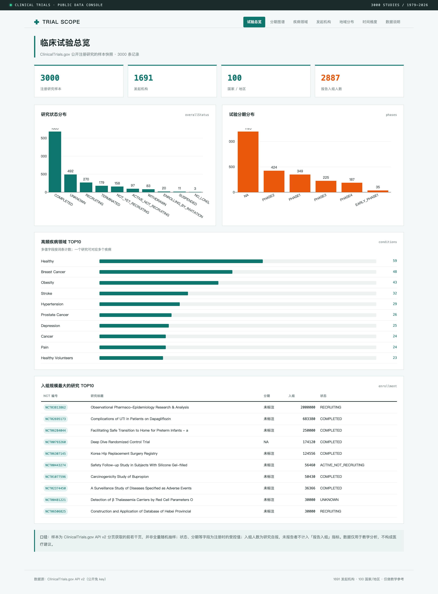
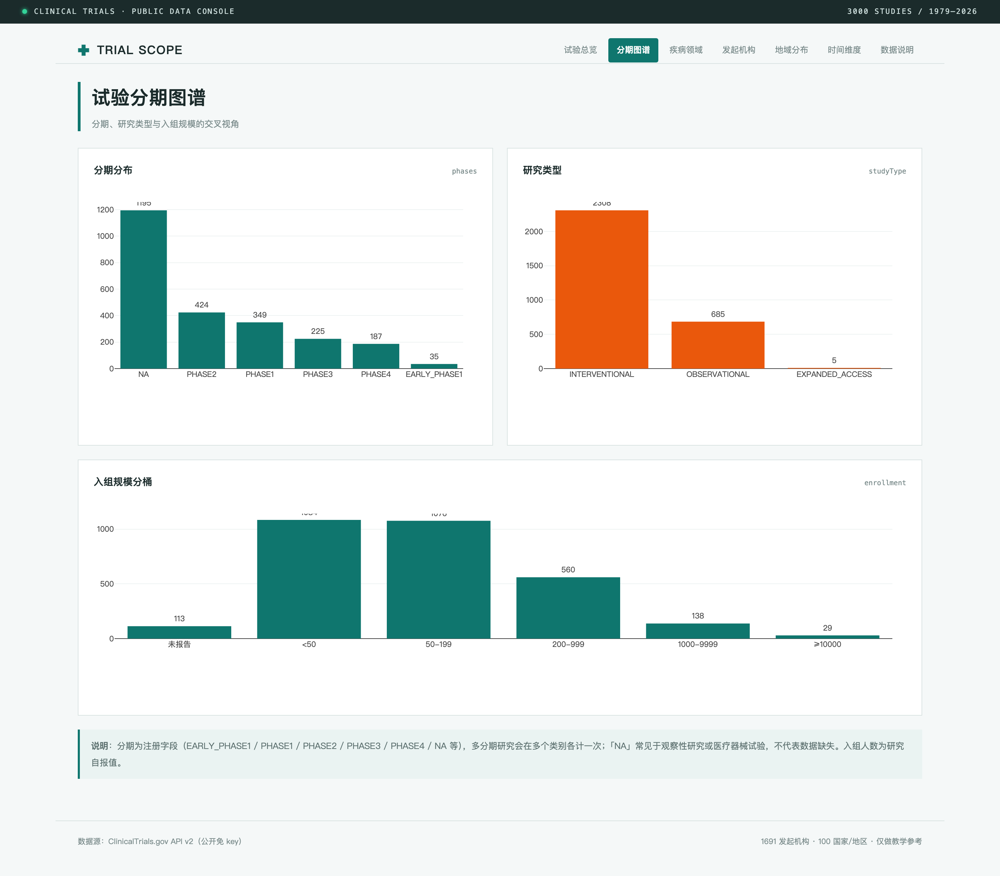
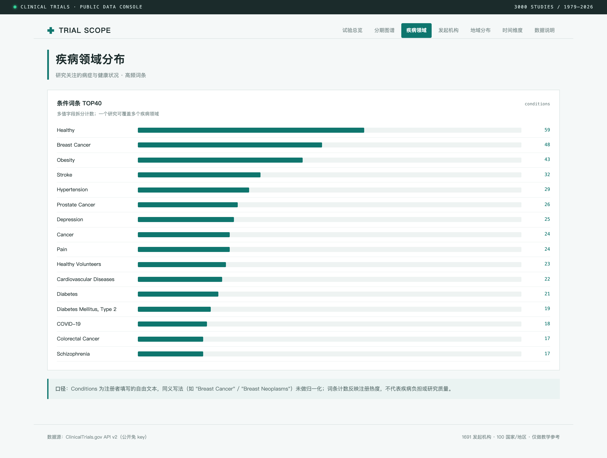
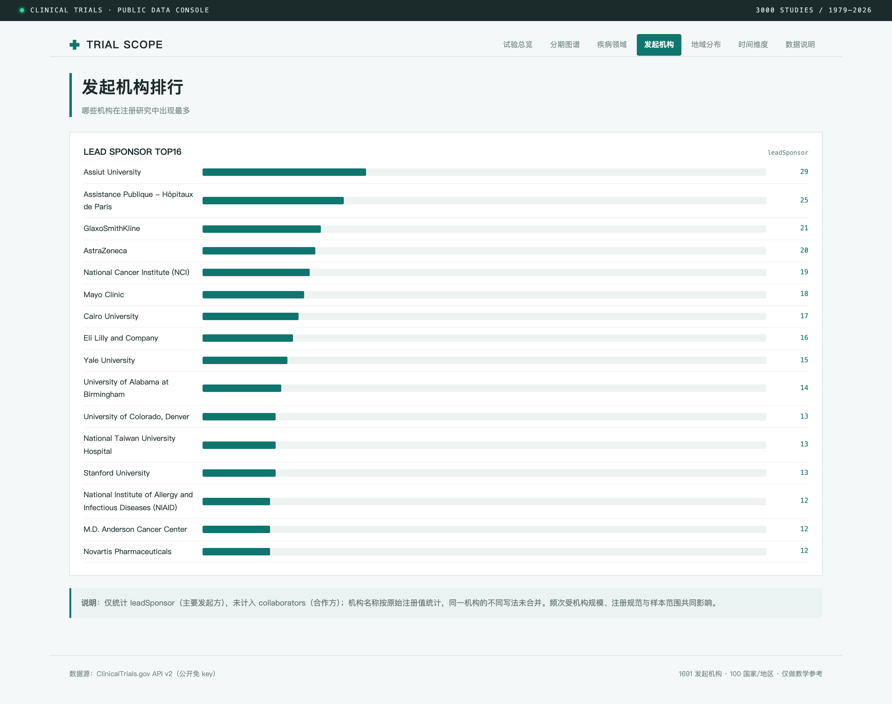
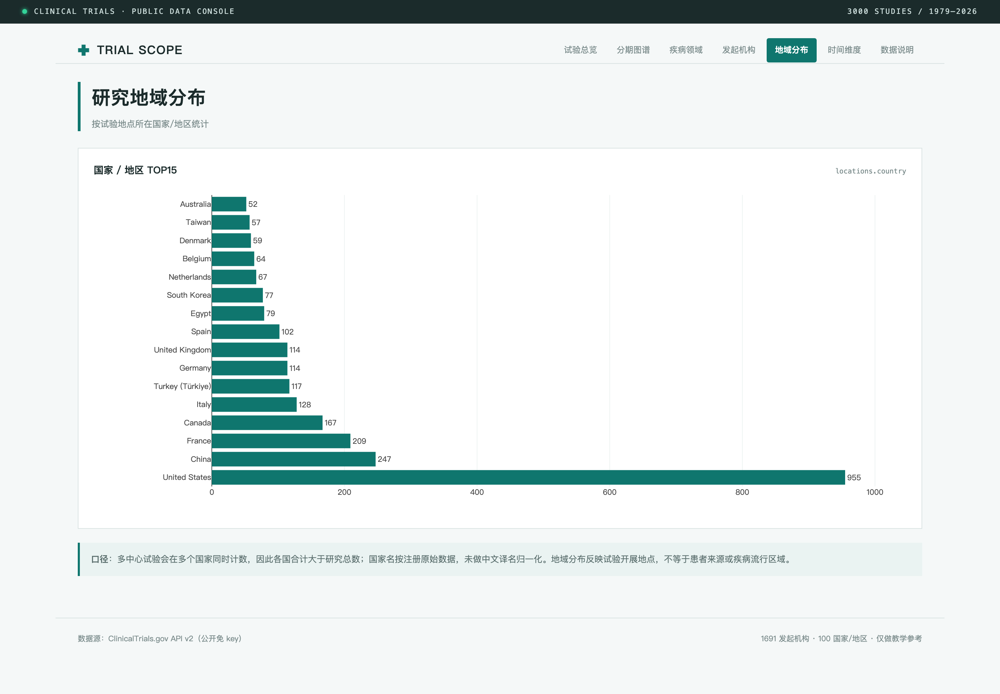
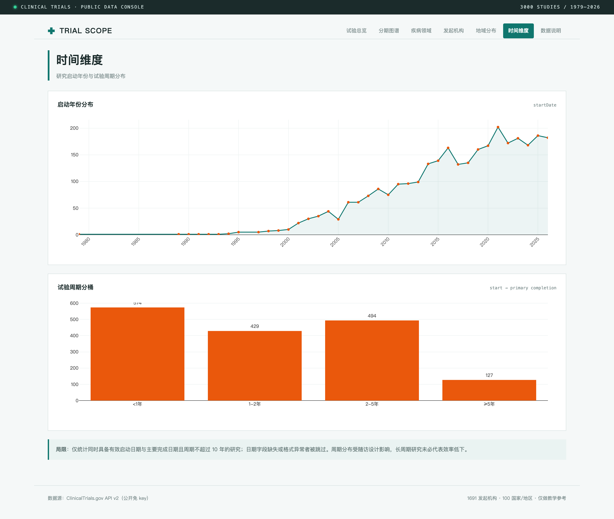
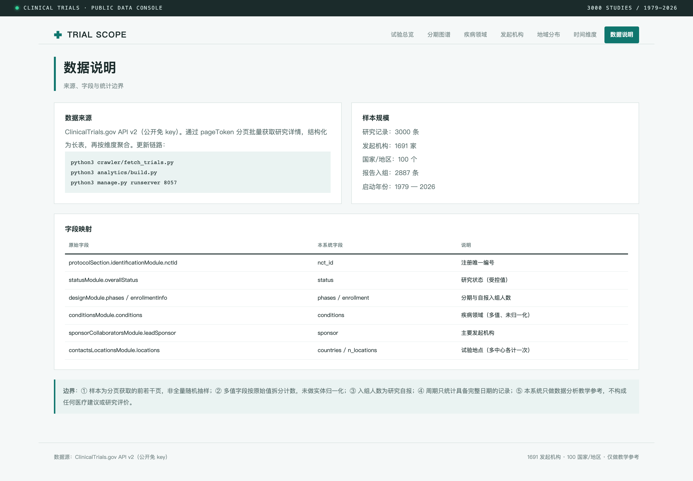

# 057 基于ClinicalTrials公开数据的临床试验分析系统-设计展示

> **代码有偿获取 可接受定制 微信联系方式: csbysj2020 或 ACE2487，备注(BS)**

> **完整源码与全套文档 · 在线自助获取 >>> [https://mbd.pub/o/bread/YZaWmJpqZA==](https://mbd.pub/o/bread/YZaWmJpqZA==)**

> **成品页（功能介绍 / 更多选题）>>> [https://bishe.suilang.net/products/trial-scope](https://bishe.suilang.net/products/trial-scope)**

> 

> 

## 视频

> **点击查看 >>> [https://www.bilibili.com/video/BV1AxyszBE2P/](https://www.bilibili.com/video/BV1AxyszBE2P/)**

## 项目简介

临床研究控制台风格（冷白底、青绿主色、等宽数字），区别于画廊/报纸/终端/看板。采集 ClinicalTrials.gov API v2 公开注册数据 3000 条，从研究状态、试验分期、疾病领域、发起机构、地域、时间、入组规模八维分析。Django + Plotly.js（本地化离线可用），7 个页面。样本分页非全量随机、多值字段未归一化、不构成医疗建议均如实标注，仅作教学参考。

临床试验注册数据是研究透明化的重要基础设施。

本项目设计并实现了一套基于 ClinicalTrials.gov 公开数据的临床试验分析系统：通过 API v2 分页获取 3000 条注册研究，结构化为长表后从研究状态、试验分期、疾病领域、发起机构、地域分布、启动年份、试验周期与入组规模八个维度聚合分析。

系统采用 Django + Plotly.js 与临床研究控制台式界面（冷白底、青绿主色、等宽数字），区别于画廊式、报纸式与通用看板风格，实现试验总览、分期图谱、疾病领域、发起机构、地域分布、时间维度、数据说明 7 个页面。

本仓库为**设计展示**：包含项目说明、技术架构、实验结果与运行截图；完整源码、任务书、开题报告、毕业论文与使用说明可通过上方链接自助获取，成品页可查看更多选题，也可联系微信咨询定制。

## 功能特性

1. 差异化视觉：临床研究控制台（冷白/青绿/等宽数字），非画廊/非报纸/非看板

2. 真实采集：ClinicalTrials.gov API v2 公开免 key，pageToken 分页 3000 条研究

3. 八维分析：状态/分期/疾病/机构/地域/启动年份/试验周期/入组规模

4. 多值字段口径：Conditions/Phases/Countries 拆分计数，未归一化如实说明

5. 发起机构：1691 家 lead sponsor 排行，不计合作方

6. 地域分布：100 个国家/地区，多中心试验各计一次

7. 时间维度：启动年份折线 + 试验周期分桶，口径边界透明

8. 技术栈差异化：Django + Plotly.js（本地化），区别于 Flask+Chart.js/ECharts 系列

9. 合规边界：分页样本非全量随机，不构成医疗建议

## 技术架构

| 项目 | 说明 |
| --- | --- |
| 编程语言 | Python 3.8+ |
| Web 框架 | Django 4.2 |
| 图表 | Plotly.js（本地化离线可用） |
| 数据源 | ClinicalTrials.gov API v2（公开免 key） |
| 样本规模 | 3000 研究 / 1691 机构 / 100 国家 |
| 运行端口 | http://127.0.0.1:8057 |
| 说明 | 数据直读 analysis JSON，无需外部服务 |

## 目录结构

以下为完整交付版的结构（本仓库仅作设计展示）：

```
trial-scope/
├── analytics/
│   └── build.py
├── crawler/
│   └── fetch_trials.py
├── data/
│   ├── analysis/
│   │   ├── conditions.json
│   │   ├── countries.json
│   │   ├── duration.json
│   │   ├── enroll.json
│   │   ├── phases.json
│   │   ├── sponsors.json
│   │   ├── statuses.json
│   │   ├── top_trials.json
│   │   ├── types.json
│   │   └── years.json
│   ├── processed/
│   │   └── trials.csv
│   └── stats.json
├── static/
│   ├── css/
│   │   └── style.css
│   └── vendor/
│       └── plotly.min.js
├── templates/
│   ├── about.html
│   ├── base.html
│   ├── conditions.html
│   ├── geography.html
│   ├── overview.html
│   ├── phases.html
│   ├── sponsors.html
│   └── timeline.html
├── trialsweb/
│   ├── __init__.py
│   ├── settings.py
│   ├── urls.py
│   ├── views.py
│   └── wsgi.py
├── wikitrack/
│   └── management/
│       └── commands/
└── …
```

## 数据与实验结论

- 实验显示样本覆盖 1691 家发起机构、100 个国家/地区，最常见状态为 COMPLETED、高频疾病领域为 Healthy。
- 真实采集：ClinicalTrials.gov API v2 公开免 key，pageToken 分页 3000 条研究
- 发起机构：1691 家 lead sponsor 排行，不计合作方
- 地域分布：100 个国家/地区，多中心试验各计一次

## 交付内容

1. 完整源码（Django 应用 + 采集器 + 分析引擎 + 7 页面）
2. 真实数据（trials.csv + analysis JSON）
3. 任务书与开题报告（Word）
4. 毕业论文（Word 七章制）
5. 二次开发说明（Word+md）
6. 7 张截图 + 封面 + 演示视频

## 常见问题

**为什么视觉风格和其他成品差这么多？**

刻意设计：临床研究控制台风格（冷白/青绿/等宽数字）替代看板/画廊/报纸，是差异化探索。

**样本是全量吗？**

不是，分页获取的前若干页，页面与论文均说明分页取样偏差。

**多值字段怎么计数？**

Conditions/Phases/Countries 拆分后每项各计一次，一个研究可在多个类别出现。

**机构名为什么没合并？**

按注册原始值统计，未做实体归一化，保留编目真实性。

**能作为医疗参考吗？**

不能。本系统只做公开注册数据的统计分析，不评价研究质量或疗效，不构成医疗建议。

## 截图








